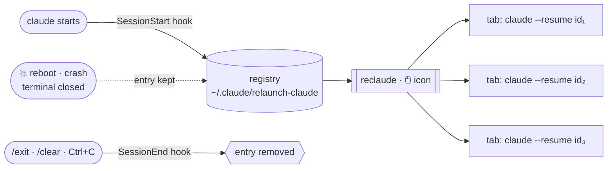
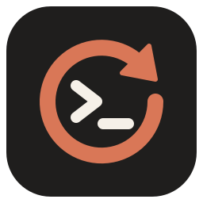

<div align="center">



<br>

[](#-ubuntu--linux)
[](#-windows)
[](https://docs.claude.com/en/docs/claude-code/hooks)
[](LICENSE)

**You had eight Claude Code sessions open. The machine rebooted.**<br>
**Type `reclaude`, or click the icon. They all come back where they stopped.**

[Install](#-install) · [How it works](#-how-it-works) · [Usage](#-usage) · [FAQ](#-faq)

</div>

<br>

<p align="center">
  
</p>

## ✨ Why

Windows updates. Power cuts. Kernel panics. A laptop lid closed one time too many.

Your Claude Code sessions don't survive a reboot, and finding them again means `cd` into each project and searching `claude --resume` one by one. **Relaunch Claude** remembers which sessions were open and puts each one back in its own tab, with the same folder, the same conversation and the same flags.

<table>
<tr>
<td width="33%" valign="top">

### ⚡ One command
`reclaude` in any terminal, or one click on the desktop icon. Each session opens as a tab in your current window.

</td>
<td width="33%" valign="top">

### 🧠 Real resume
Each tab runs `claude --resume <id>`. You get the full conversation back, not a fresh start in the right folder.

</td>
<td width="33%" valign="top">

### 🎛️ Same flags
`--dangerously-skip-permissions`, `--permission-mode`, `--model`, `--add-dir`… are re-applied to each session automatically.

</td>
</tr>
<tr>
<td valign="top">

### 🎯 Only what was interrupted
Sessions you closed with `/exit` stay closed. Sessions still running are left alone.

</td>
<td valign="top">

### 🪶 Zero dependencies
Python 3 on Linux, PowerShell on Windows. Both ship with the OS. No daemon, no background service.

</td>
<td valign="top">

### 🧹 Clean exit
The installer merges into your `settings.json` and keeps a backup. The uninstaller removes every trace.

</td>
</tr>
</table>

## 🚀 Install

### 🐧 Ubuntu / Linux

```bash
git clone https://github.com/Flo976/relaunch-claude.git
cd relaunch-claude
./linux/install.sh            # add --autostart to relaunch automatically at login
```

### 🪟 Windows

```powershell
git clone https://github.com/Flo976/relaunch-claude.git
cd relaunch-claude
.\windows\install.cmd         # or: powershell -ExecutionPolicy Bypass -File windows\install.ps1 -Autostart
```

<details>
<summary><b>What the installer does</b></summary>

<br>

| | Linux | Windows |
|---|---|---|
| Hook added to | `~/.claude/settings.json` | `%USERPROFILE%\.claude\settings.json` |
| Backup | `settings.json.bak-relaunch-claude` | `settings.json.bak-relaunch-claude` |
| `reclaude` command | `~/.local/bin/reclaude` | `%LOCALAPPDATA%\relaunch-claude\bin` (added to your user PATH) |
| Icon | application menu + desktop | desktop + Start menu |
| `--autostart` / `-Autostart` | `~/.config/autostart` | Startup folder |

Your existing hooks are kept. Running the installer again doesn't create duplicates.

</details>

> [!IMPORTANT]
> Only sessions started **after** installation are tracked. Restart the sessions you have open once, and you're covered.

## 🔍 How it works



1. A [Claude Code hook](https://docs.claude.com/en/docs/claude-code/hooks) records every session that starts: id, folder, transcript, flags and the path to `claude`.
2. Leaving on purpose (`/exit`, `/clear`, `Ctrl+C` twice) removes the session from the registry.
3. An interrupted session (reboot, crash, terminal closed) stays in the registry.
4. `reclaude` reopens every recorded session whose process isn't running any more, then hands the registry over to the resumed sessions, which register themselves again.

## 🕹️ Usage

```bash
reclaude              # reopen every interrupted session as a tab
reclaude list         # what is tracked: running / interrupted
reclaude --dry-run    # show what would open, without opening anything
```

### Configuration (optional)

`~/.claude/relaunch-claude/config.json`

```jsonc
{
  "terminal": "auto",   // Linux: gnome-terminal, ptyxis, konsole, xfce4-terminal, kgx, kitty, alacritty, wezterm, xterm
  "claude_args": []     // extra flags for every relaunched session
}
```

<details>
<summary><b>Supported terminals</b></summary>

<br>

- **Linux**: GNOME Terminal, Ptyxis, Konsole, XFCE Terminal, GNOME Console, Kitty, Alacritty, WezTerm, xterm. Detected in that order.
- **Windows**: Windows Terminal, with tabs in the current window for `reclaude` and a dedicated window for the icon. Falls back to separate PowerShell windows.

</details>

## ❓ FAQ

<details>
<summary><b>I closed a tab with the ✕ button and it came back</b></summary>

<br>

From Claude Code's point of view, closing the terminal window looks exactly like a crash, so the session counts as interrupted. To close a session for good, use `/exit`.
</details>

<details>
<summary><b>A session reopened empty, without its conversation</b></summary>

<br>

That session never wrote a transcript: no message was sent, or persistence was off. It is reopened as a fresh `claude` in the same folder.

Sessions launched from **inside** another Claude session inherit `CLAUDE_CODE_CHILD_SESSION`, which turns off transcript writing. Relaunched tabs clear it and set `CLAUDE_CODE_FORCE_SESSION_PERSISTENCE=1`, so their history keeps being saved.
</details>

<details>
<summary><b>Will it open the same session twice?</b></summary>

<br>

No. Sessions whose process is still running are skipped, and every relaunched entry is removed from the registry until the resumed session registers itself again.
</details>

<details>
<summary><b>What gets cleaned up automatically?</b></summary>

<br>

Entries older than 30 days, and entries whose folder no longer exists.
</details>

## 🗑️ Uninstall

```bash
./linux/uninstall.sh
```
```powershell
powershell -ExecutionPolicy Bypass -File windows\uninstall.ps1
```

The hook, the `reclaude` command, the icons and the registry are removed.

<br>

<div align="center">



<sub>MIT licensed · Community tool, not affiliated with Anthropic · If it saved your morning, leave a ⭐</sub>

</div>
