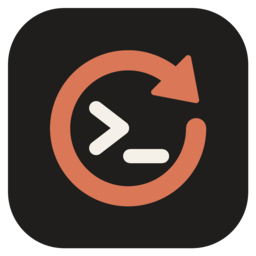

<p align="center"></p>

# Relaunch Claude

**One click to bring back every Claude Code session after a reboot.**

You had eight Claude Code terminals open, each one in a different project, and the machine shut down: update, power cut, crash. Relaunch Claude reopens each one in its own terminal tab, in the right folder, with `claude --resume <session-id>`. Every conversation picks up where it stopped.

Works on **Ubuntu / Linux** (GNOME Terminal, Ptyxis, Konsole, XFCE, Kitty, Alacritty, WezTerm…) and **Windows** (Windows Terminal, or PowerShell windows as a fallback).

## How it works

1. A small [Claude Code hook](https://docs.claude.com/en/docs/claude-code/hooks) runs on `SessionStart` and `SessionEnd`. It keeps a registry of open sessions in `~/.claude/relaunch-claude/sessions/`: session id, folder, transcript and launch flags.
2. When you leave a session on purpose (`/exit`, `Ctrl+C` twice, `/clear`), the hook removes it from the registry.
3. When a session is interrupted (shutdown, crash, terminal closed), its entry stays.
4. The **Relaunch Claude** icon reopens every interrupted session that isn't still running, then shows a notification.

Each relaunched session gets the flags it was started with: `--dangerously-skip-permissions`, `--permission-mode`, `--model`, `--add-dir`…

## Install

### Ubuntu / Linux

```bash
git clone https://github.com/Flo976/relaunch-claude.git
cd relaunch-claude
./linux/install.sh              # add --autostart to relaunch automatically at login
```

Requires `python3`, which ships with Ubuntu. The installer:
- adds the hook to `~/.claude/settings.json`. Your existing hooks are kept and a backup is written to `settings.json.bak-relaunch-claude`
- adds **Relaunch Claude** to the application menu and to the desktop

### Windows

```powershell
git clone https://github.com/Flo976/relaunch-claude.git
cd relaunch-claude
.\windows\install.cmd           # or: powershell -ExecutionPolicy Bypass -File windows\install.ps1 [-Autostart]
```

The installer adds the hook to `%USERPROFILE%\.claude\settings.json` and creates a **Relaunch Claude** shortcut on the desktop and in the Start menu.

> Only sessions started **after** installation are tracked. Restart the sessions you have open once, and you're covered.

## Usage

| | Linux | Windows |
|---|---|---|
| Relaunch | click the icon | double-click the shortcut |
| See what is tracked | `python3 ~/.local/share/relaunch-claude/relaunch_claude.py list` | `relaunch-claude.ps1 -List` |
| Preview without launching | `… relaunch_claude.py --dry-run` | `relaunch-claude.ps1 -DryRun` |

### Optional configuration

`~/.claude/relaunch-claude/config.json`:

```json
{
  "terminal": "auto",
  "claude_args": []
}
```

- `terminal` (Linux): `auto`, or one of `gnome-terminal`, `ptyxis`, `konsole`, `xfce4-terminal`, `kgx`, `kitty`, `alacritty`, `wezterm`, `xterm`
- `claude_args`: extra flags added to every relaunched session

## Good to know

- **Closing a terminal with the window's ✕ counts as an interruption**, so that session comes back on the next relaunch. To close a session for good, use `/exit`.
- A session that never wrote a transcript (no message sent) is reopened as a fresh `claude` in the same folder.
- Entries older than 30 days, and entries whose folder no longer exists, are dropped.
- Sessions opened from inside another Claude session inherit `CLAUDE_CODE_CHILD_SESSION`, which turns off transcript writing. Relaunched tabs clear it and set `CLAUDE_CODE_FORCE_SESSION_PERSISTENCE=1`, so their history keeps being saved.

## Uninstall

```bash
./linux/uninstall.sh
```
```powershell
powershell -ExecutionPolicy Bypass -File windows\uninstall.ps1
```

Both remove the hook from `settings.json`, the icons and the registry.

## License

MIT. This is a community tool and is not affiliated with Anthropic.
